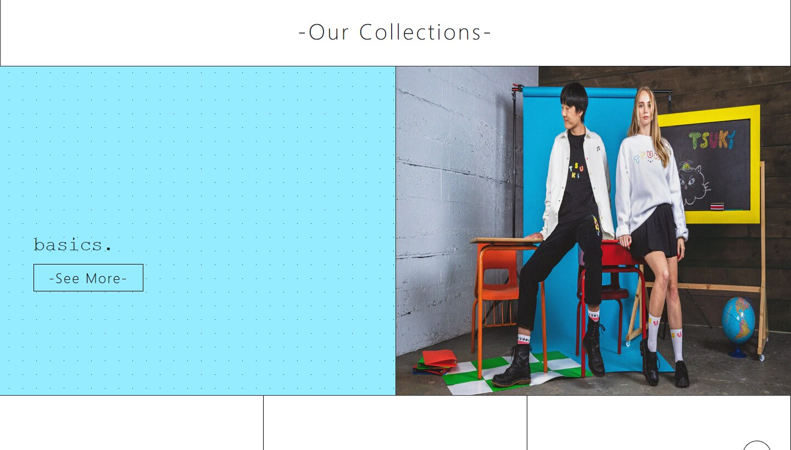
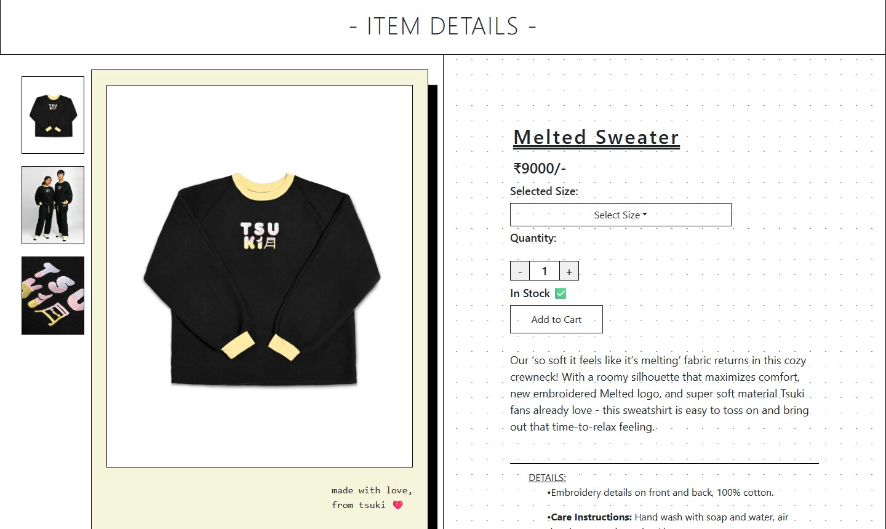
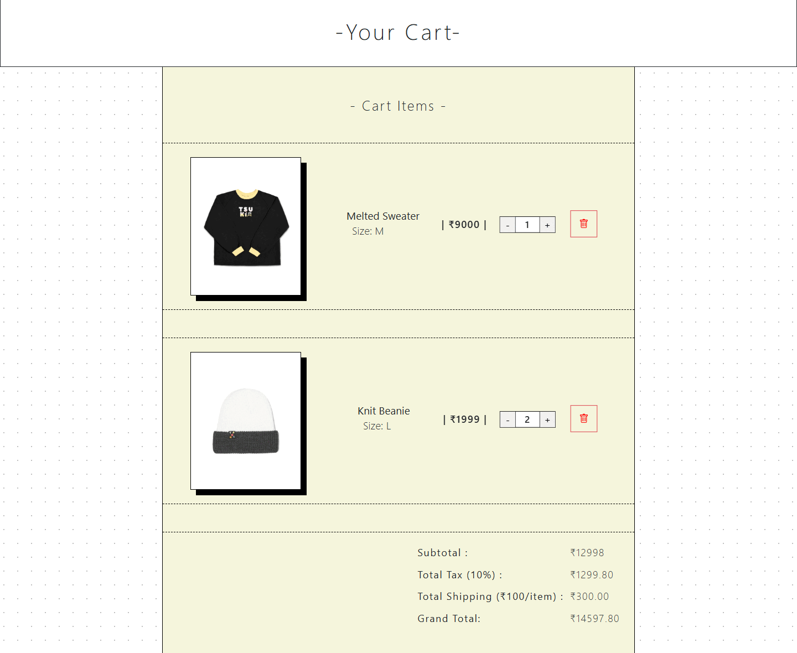
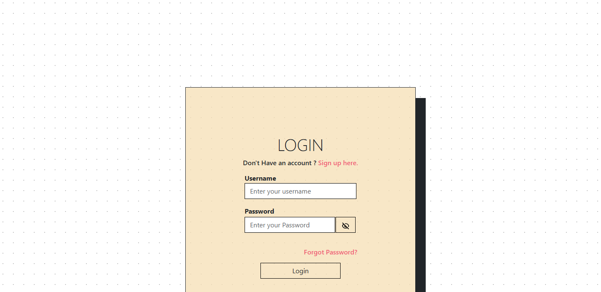
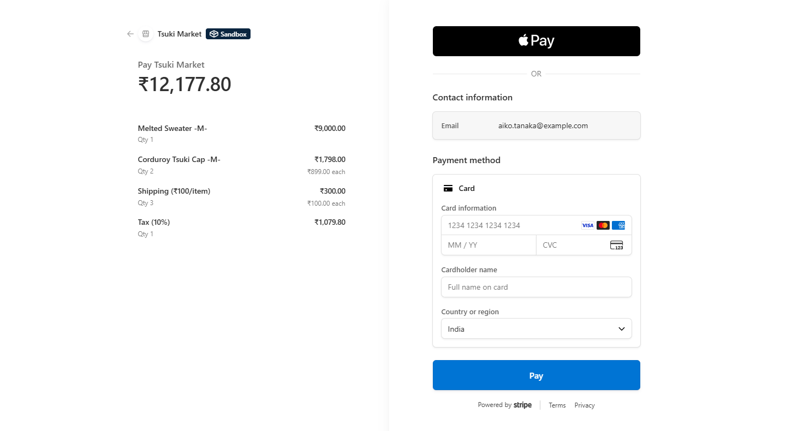
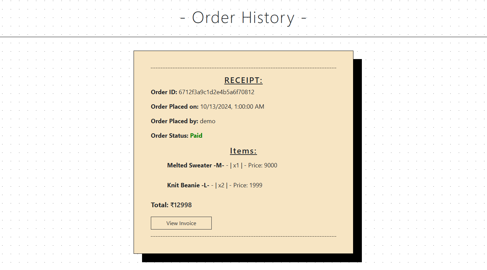
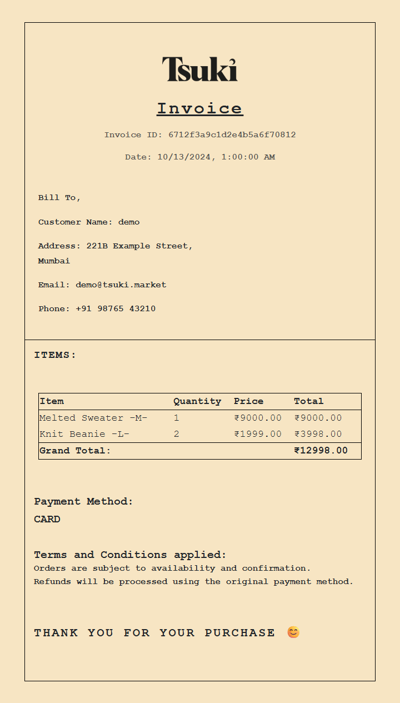
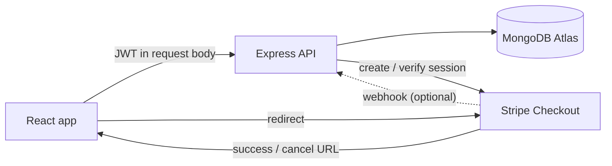

<p align="center">
  
</p>

<p align="center">
  <b>Tsuki Market</b> is a full-stack clothing store built on the MERN stack, with Stripe checkout, JWT auth, order history and downloadable PDF invoices.
</p>

<p align="center">
  <a href="https://tsukimarket.vercel.app"><b>Live demo</b></a> ·
  <a href="#screenshots">Screenshots</a> ·
  <a href="#development-setup">Run it locally</a> ·
  <a href="#api-documentation">API</a>
</p>

<p align="center">
  
  
  
  
  
</p>

> Demo project made for fun and to learn React and Node.js. It's not a real store, so use a Stripe test card if you try checkout: `4242 4242 4242 4242`, or `4000 0035 6000 0008` for an India-based Stripe account (any future date, any CVC).

---


## Features

- **Shop**: three collections (basics, melts, knits), product pages with an image gallery, size picker and quantity selector, plus search.
- **Cart**: kept in `localStorage`, with live subtotal, 10% tax and ₹100/item shipping.
- **Checkout**: Stripe Checkout. The server rebuilds the cart from its own catalog, so prices can't be changed from the browser.
- **Accounts**: sign up and login with bcrypt-hashed passwords and JWTs, and a profile page to add phone and address.
- **Orders**: order history with paid/cancelled status. An order is only marked paid after the server checks the Stripe session.
- **Invoices**: printable invoice per order, downloadable as a PDF (html2canvas + jsPDF).
- **Extras**: lazy-loaded images, a loading screen, toast notifications, social sharing, and Vercel Speed Insights.

## Screenshots

| Collections | Product page |
|---|---|
|  |  |

| Cart | Login |
|---|---|
|  |  |

**Stripe Checkout (sandbox)**: line items, shipping and tax are priced on the server from the catalog, so a tampered cart can't change what gets charged.



| Order history | Invoice (exports to PDF) |
|---|---|
|  |  |

## Architecture



### Frontend (`Client/`)
- React 18 with React Router 6 and Bootstrap 5
- Cart state in a React context, persisted to `localStorage`
- Redirects to Stripe's hosted Checkout page using the session URL from the server
- `react-jwt` to read the token, `axios` for API calls
- `html2canvas` + `jspdf` for invoice PDFs

### Backend (`Server/`)
- Express 4 and the official MongoDB driver
- `bcrypt` for password hashing, `jsonwebtoken` for auth
- `stripe` for creating and verifying checkout sessions, plus an optional webhook
- Serves the production React build from `Server/build`

## Project Structure

```
├── Client/                 # React frontend
│   ├── public/             # static assets and product images
│   ├── src/Components/     # pages + components (cart context, checkout, invoice, ...)
│   └── .env.example
│
├── Server/                 # Express backend
│   ├── controllers/        # auth, payment, user data, db connection
│   ├── routes/             # /auth, /db and /webhook routes
│   ├── build/              # production build of the client, served by app.js
│   ├── items.json          # product catalog (source of truth for prices)
│   ├── app.js
│   └── .env.example
│
├── scripts/               # db-setup.mjs (indexes, seed, migrations), smoke-test.mjs
│
└── Doc/                    # reports, slides and screenshots
```

## API Documentation

### Authentication (`/auth`)

| Method | Endpoint | Body | Returns |
|---|---|---|---|
| POST | `/auth/signup` | `{ username, email, password }` | confirmation message |
| POST | `/auth/login` | `{ username, password }` | JWT (6h) |

### Store and user (`/db`)

| Method | Endpoint | Body | Notes |
|---|---|---|---|
| GET | `/db/items` | | all products |
| POST | `/db/user_phone` | `{ token, phone }` | returns a refreshed JWT |
| POST | `/db/user_address` | `{ token, address }` | returns a refreshed JWT |
| POST | `/db/order_history` | `{ token }` | paid and cancelled orders of the user |
| POST | `/db/invoice` | `{ token, id }` | only returns orders owned by the user |
| POST | `/db/payment` | `{ token, cart }` | creates a Stripe Checkout session, returns `{ id, url }` |
| POST | `/db/payment_status` | `{ token, status: "ok", session_id }` or `{ token, status: "fail", order_id }` | verifies with Stripe before marking an order paid |

Prices are always taken from `Server/items.json`, never from the cart sent by the client.

### Webhook (`/webhook`)
Optional, enabled when `STRIPE_WEBHOOK_SECRET` is set. `checkout.session.completed` marks the order paid even if the user closes the tab before reaching the success page.

## Development Setup

Needs Node 18+, a MongoDB Atlas cluster (the free tier is fine) and a Stripe account in test mode.

1. **Backend**
   ```bash
   cd Server
   cp .env.example .env   # MongoDB URI, JWT key, Stripe secret key
   npm install
   npm run dev            # http://localhost:8181
   ```

2. **Frontend**
   ```bash
   cd Client
   cp .env.example .env   # REACT_APP_API_ENDPOINT=http://localhost:8181
   npm install
   npm start              # http://localhost:3000
   ```

3. **Database**
   ```bash
   node scripts/db-setup.mjs
   ```

4. **Webhook (optional locally)**
   ```bash
   stripe listen --forward-to localhost:8181/webhook   # put the whsec_... it prints in Server/.env
   ```
   In production the endpoint is `https://<your-domain>/webhook` listening for `checkout.session.completed`.

### Environment variables

| Variable | Where | Description |
|---|---|---|
| `MONGODB_URI` | Server | MongoDB connection string |
| `JWT_KEY` | Server | secret used to sign tokens |
| `STRIPE_SECRET_KEY` | Server | Stripe secret key (`sk_test_...`) |
| `STRIPE_WEBHOOK_SECRET` | Server | optional, enables `/webhook` |
| `CLIENT_ORIGIN` | Server | optional, comma separated CORS allowlist |
| `PORT` | Server | defaults to `8181` |
| `REACT_APP_API_ENDPOINT` | Client | URL of the backend |

Secrets live only in the local `.env` files, which are git-ignored.

### Tests
```bash
cd Client && npm test     # cart totals, localStorage, quantity selector
cd Server && npm test     # API tests with MongoDB and Stripe stubbed (no network needed)
```

### Database setup
Seeds the `Items` collection, creates indexes (unique username/email, order lookups), hashes any leftover plaintext passwords, and marks orders paid if Stripe says they were. Safe to run more than once.
```bash
node scripts/db-setup.mjs            # add --dry-run to only see what it would do
```

### Smoke test
Runs the main API flows against any deployment: sign-up, login, profile, checkout with a tampered price, and payment verification. It creates a throwaway `tsuki_smoke_*` user.
```bash
node scripts/smoke-test.mjs                         # https://tsukimarket.vercel.app
node scripts/smoke-test.mjs http://localhost:8181   # local server
```

## Deployment
- **Backend + built frontend**: Vercel (`Server/vercel.json`), with `app.js` serving `Server/build`
- **Frontend only**: Netlify (`Client/netlify.toml`)
- **Docker**: a `Dockerfile` in both `Client/` and `Server/`. Pass env at runtime with `docker run --env-file .env ...`

To refresh the build that the server serves:
```bash
cd Client && BUILD_PATH=../Server/build npm run build
```

## Security
- Passwords hashed with bcrypt. Old plaintext accounts are upgraded on their next login.
- JWT auth, and every user-data route checks that the token owns the data.
- Server-side pricing and Stripe session verification before an order counts as paid.
- Login and signup only accept string input, which blocks MongoDB operator injection.
- No secrets in the repo; see the `.env.example` files.

## Author
Made by **Deeptanshu Lal**
